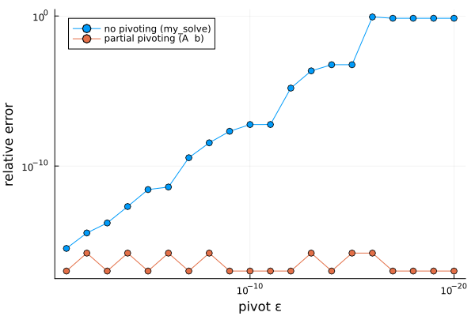

# Week 1: Gaussian elimination and LU

## Problem
What it solves (input -> output), and when a solution exists.

## Idea
Elimination in one paragraph, and why it produces A = LU.

## Cost
Factor: ... flops. Each solve: ... flops. My measured slopes (E2): ...

## Accuracy and stability
- Not suitable for zero pivot;
- Unstable when pivot is very small.

## When to use it / when not to
...

## My best plot

As pivot decrease to small number, the backward error increase.
Compares to standard method, to choose pivot will reduce the error.
The algorithm determine the backward error.

## Open questions
Things I still don't understand.